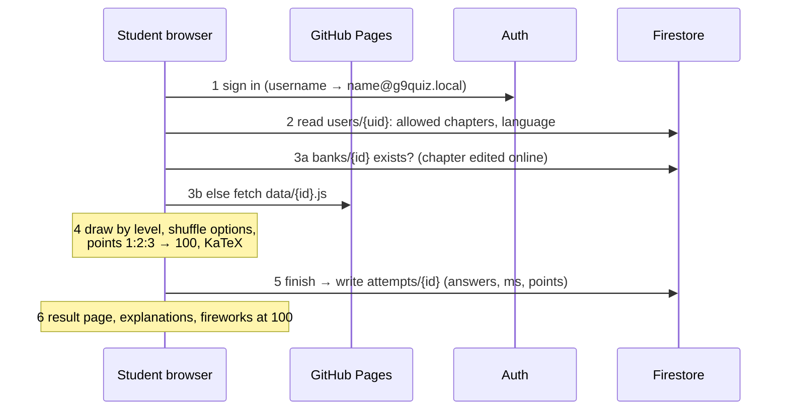
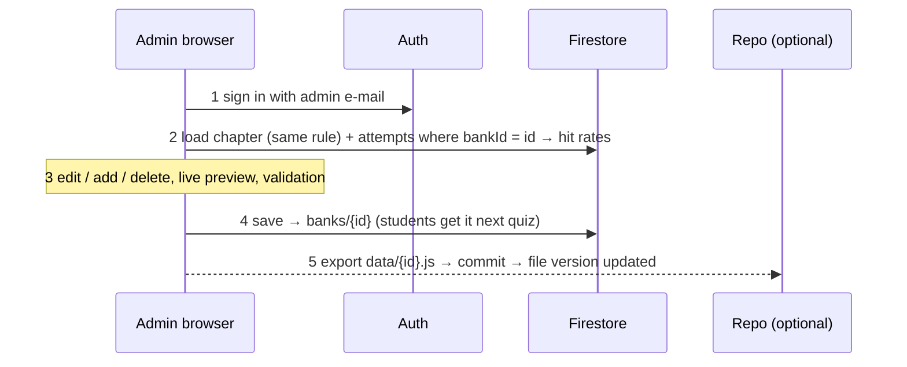

# Architecture

Full write-up with diagrams: **[docs/architecture.html](https://samolkhoeurn.github.io/quiz/docs/architecture.html)** (served by GitHub Pages).

## System map

No server of our own. The browser downloads the app from GitHub Pages, typesets maths with KaTeX from a CDN, and talks directly to Firebase. Questions have two homes: the files in git (master copy) and, for chapters edited online, a `banks/{id}` document in Firestore that overrides the file.

```mermaid
flowchart LR
  subgraph laptop [Your laptop]
    repo[quiz/ folder<br/>GitHub Desktop]
  end
  subgraph github [GitHub / CDN - free]
    gh[(Repository)]
    pages[GitHub Pages<br/>app.js · subjects.js<br/>53 question files]
    katex[jsDelivr: KaTeX]
  end
  subgraph browsers [Browsers]
    student[Student<br/>Khmer or English UI<br/>draw 25/15 · shuffle · 100 pts]
    admin[Admin<br/>students · reports<br/>question manager]
  end
  subgraph firebase [Firebase - free tier]
    auth[Authentication]
    fs[(Firestore<br/>users · attempts · banks)]
  end
  repo -- push --> gh -- publishes --> pages
  pages --> student
  pages --> admin
  katex --> student
  student -- sign in --> auth
  admin -- sign in --> auth
  student -- read users, banks<br/>write attempts --> fs
  admin -- write users, banks<br/>read attempts --> fs
  admin -. export .js .-> repo
```

## The two flows





## Collections

| Collection | Document | Who reads | Who writes |
|---|---|---|---|
| `users/{uid}` | name, username, allowed[], active, lang | the student (own), admin | admin |
| `attempts/{id}` | uid, bankId, points, score, total, answers[{i, chosen, correct, pts, ms}] | the student (own), admin | the student (create), admin |
| `banks/{bankId}` | id, subject, title, quizSize, questions[] | any signed-in user | admin |

## Limits that matter first

| Concern | Today | Comfortable up to | What breaks first |
|---|---|---|---|
| Students | created one by one | ~30 | no password reset without server code |
| Admins | one hard-coded e-mail | 1 | a second teacher needs a `role` field |
| Questions | 53 chapters, 2,211 q, editable online | thousands | review effort; keys visible client-side |
| Reports / hit rates | aggregate attempts in browser | ~1,000 attempts per student/chapter | add `summary/{uid}` |
| Firestore free tier | tens of ops/day | ~300 students × 1 quiz/day | 50k reads/day, then pay-as-you-go |

## Scale tiers

Tier 1 (today): one admin, question manager, grading in browser. Tier 2: `users.role`, `summary/{uid}`, one Cloud Function for password resets/bulk accounts. Tier 3: server-side grading (keys never leave the server), per-question documents, organisations and classes.

The question format `{lv, q, o, a, ex}` and the attempt record are the same in files, Firestore and reports, and stay stable across tiers.
